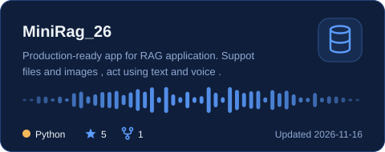
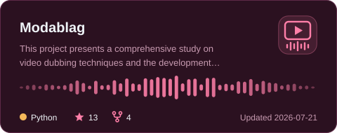
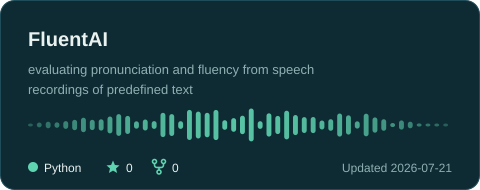

<h1 align="center">Hi 👋, I'm ElSebaiy Mohammed (Sab3wi)</h1>
<h3 align="center">AI/NLP Engineer • Arabic Speech AI Specialist (ASR · TTS · Speech-to-Speech) 🇪🇬</h3>

  Cairo, Egypt · Open to remote &amp; Egypt-based roles  
  
  

---

## 🎯 What I do

I'm an AI/NLP engineer with ~4 years of experience building speech and language systems, focused on Arabic and its dialects. I take models from research notebook to deployed service: fine-tuning, evaluation, and production deployment.

**What I can build for you**

- Arabic / dialect ASR, TTS, and full speech-to-speech pipelines
- Automatic video dubbing and speech translation
- Pronunciation and fluency assessment for language-learning products
- RAG and LLM-powered apps, from prototype to deployed API
- Model optimization for production (ONNX, quantization, parameter-efficient fine-tuning)

## 🚀 Featured Work

  
  
  
  

Highlights: Modablag is an English→Arabic dubbing pipeline (Wav2Vec2 ASR, NMT, FastSpeech2 TTS, punctuation, tashkeel). FluentAI scores pronunciation, fluency, and content (Wav2Vec2 + CTC forced alignment, **88% accuracy**). MiniRag_26 is a production-style RAG backend with PgVector, Celery, Docker Compose, and Prometheus/Grafana. Speak Lab is a Gradio speaking-practice app on Hugging Face Spaces.

## 💬 Ask me about

- Arabic ASR, TTS, and speech-to-speech pipelines
- Fine-tuning Wav2Vec2, Whisper, SpeechT5, HiFi-GAN (CTC, LoRA/PEFT, layer freezing)
- Pronunciation and fluency assessment (forced alignment, CTC)
- Production RAG apps and serving models with FastAPI & Docker
- Deep Learning (PyTorch, TensorFlow, Hugging Face Transformers), NLP
- Math for ML (Linear Algebra, Calculus, Probability & Statistics)

## 📄 Publications

- *Springer, BMC Artificial Intelligence* (2025), co-authored with Dr. Amal. <!-- add paper title + DOI link -->
- A second paper is under review in a Q1/Q2 journal.

## 🏆 Competitions

- Top 18/100, Arabic Summarization Challenge (ROUGE-L 19.2)
- [Bengali.AI Speech Recognition](https://github.com/ElsebaiyMohamed/BnSR) (Kaggle, out-of-distribution ASR): WER 0.89

## 🐛 Open-source

- Issue filed: [huggingface/transformers#28002](https://github.com/huggingface/transformers/issues/28002)

## 🛠️ Core Stack

  
  
  
  
  
  
  
  
  
  

---

## 💻 GitHub in numbers

  

  

Cards are generated by a GitHub Action every 6 hours from the GitHub API.
