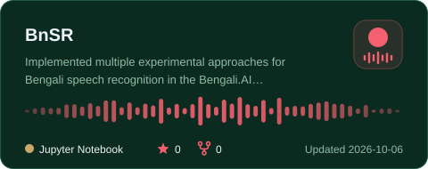
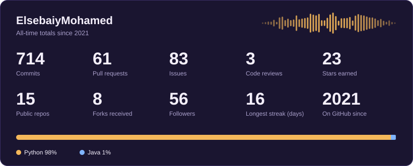

  
 
        
 
Ranks from <a href="https://gitranks.com/profile/ElsebaiyMohamed">GitRanks</a>, refreshed daily
 
    
 
     
 

## 🎯 What I do

I'm an AI/NLP engineer with ~4 years of experience building speech and language systems, focused on Arabic and its dialects. I take models from research notebook to deployed service: fine-tuning, evaluation, and production deployment.

**What I can build for you**

- Arabic / dialect ASR, TTS, and full speech-to-speech pipelines
- Automatic video dubbing and speech translation
- Pronunciation and fluency assessment for language-learning products
- RAG and LLM-powered apps, from prototype to deployed API
- Model optimization for production (ONNX, quantization, parameter-efficient fine-tuning)

## 🚀 Featured Work

  
  
  
  

| Project | What it does | Built with |
| --- | --- | --- |
| [**Modablag**](https://github.com/ElsebaiyMohamed/Modablag) | End-to-end English→Arabic video dubbing | Wav2Vec2 ASR, NMT, FastSpeech2 TTS, punctuation, tashkeel |
| [**FluentAI**](https://github.com/ElsebaiyMohamed/FluentAI) | Pronunciation, fluency, and content scoring (**88% accuracy**) | Wav2Vec2, CTC forced alignment, FastAPI |
| [**MiniRag_26**](https://github.com/ElsebaiyMohamed/MiniRag_26) | Production-style RAG backend | FastAPI, PgVector, Celery, Docker Compose, Prometheus/Grafana |
| [**BnSR**](https://github.com/ElsebaiyMohamed/BnSR) | Out-of-distribution Bengali speech recognition (Kaggle) | Wav2Vec2-CTC, SpeechT5, LoRA/PEFT |

## 💬 Ask me about

<b>Speech and language</b>

 

- Arabic ASR, TTS, and speech-to-speech pipelines
- Fine-tuning Wav2Vec2, Whisper, SpeechT5, HiFi-GAN (CTC, LoRA/PEFT, layer freezing)
- Pronunciation and fluency assessment (forced alignment, CTC)

<b>Engineering and deployment</b>

 

- Production RAG apps and serving models with FastAPI & Docker
- Model optimization: ONNX, quantization
- Deep Learning (PyTorch, TensorFlow, Hugging Face Transformers), NLP

<b>Foundations</b>

 

- Math for ML: Linear Algebra, Calculus, Probability & Statistics

## 🔧 Core Stack

  
  
  
  
  
  
  
  
  
  

## 💻 GitHub in numbers

  

  

  
  

  

  

Charts are generated from the GitHub API by an Action that runs once a day.

<b>📄 Publications</b>

 

**Publications**

- *Springer, BMC Artificial Intelligence* (2025), co-authored with Dr. Amal. [doi: 10.1186/s44398-025-00006-5](https://doi.org/10.1186/s44398-025-00006-5)

